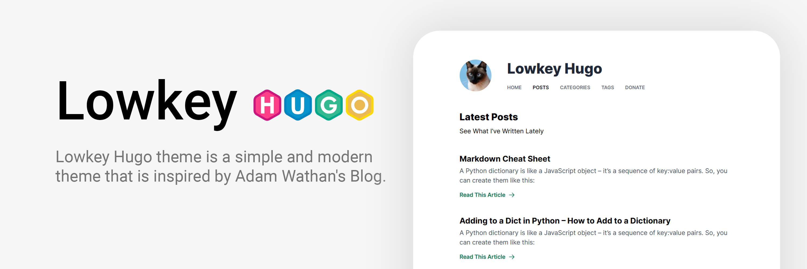

# Lowkey Hugo Theme



**Lowkey Hugo theme** is a simple and modern theme that is inspired by [Adam Wathan's Blog](https://adamwathan.me/). It is built using Tailwind CSS, which allows for easy customization. The theme features a minimalistic and streamlined layout, with a focus on readability and ease of use. With its lightweight code and fast loading times, Lowkey Hugo theme is a great choice for a personal blog, a portfolio or project documentation.

## Demo & Documentation

- **Demo:** [lowkey.nixentric.com](https://lowkey.nixentric.com)
- **Documentation:** [lowkey.nixentric.com/docs](https://lowkey.nixentric.com/docs/)

## Features

- Clean, readable single-column layout with the Inter typeface
- True black (OLED) dark mode that follows the system setting, with a toggle and no flash on load
- Friendly dates: "3 days ago" for new posts, a localized date such as "August 3, 2026" for older ones
- Documentation pages with a sidebar generated from your folders
- Shortcodes for alerts, captioned images and task lists
- Syntax highlighting, tables, footnotes, math (MathJax) and emoji
- Table of contents per post
- Categories and tags with post counts
- Comments with [giscus](https://giscus.app) or Disqus
- Meta descriptions, canonical links, `robots.txt`, sitemap, RSS and Google Analytics 4
- Translations for English, Portuguese and Indonesian
- Mobile friendly, with no sideways scrolling
- Every template can be overridden from your own site

## Requirements

- [Hugo](https://gohugo.io/installation/) v0.158.0 or newer
- [Node.js](https://nodejs.org/) (LTS) and npm, for Tailwind CSS
- Git

## Installation

Create a site, add the theme and copy the example site into it:

```bash
hugo new project my-blog
cd my-blog
git init
git submodule add https://github.com/nixentric/Lowkey-Hugo-Theme.git themes/enchanted-lowkey
rm hugo.toml
cp -R themes/enchanted-lowkey/ExampleSite/. .
npm install
hugo server
```

Open http://localhost:1313. If you use SSH with GitHub, `git@github.com:nixentric/Lowkey-Hugo-Theme.git` works as the submodule URL too.

The [installation guide](https://lowkey.nixentric.com/docs/getting-started/installation/) explains each step and how to fix common errors. Everything else, from configuration to dark mode, comments and custom templates, is in the [documentation](https://lowkey.nixentric.com/docs/).

## Updating

```bash
git submodule update --remote --merge
```

### Upgrading from an older version

The theme now requires Hugo v0.158.0 or newer. Rename these settings in your site's config:

| Old setting                        | New setting                             |
| ---------------------------------- | --------------------------------------- |
| `languageCode = 'en-US'`           | `locale = 'en-US'`                      |
| `paginate = 5`                     | `[pagination]` → `pagerSize = 5`        |
| `disqusShortname` in `params.toml` | `[services.disqus]` → `shortname = '…'` |

Recent Hugo versions ignore `paginate` without a warning, so lists fall back to 10 posts per page until it is renamed. The `type: taxonomies` and `layout: "home"` lines in `content/categories/_index.md` and `content/tags/_index.md` are no longer needed.

## Technology

- [Hugo](https://gohugo.io/)
- [Tailwind CSS](https://tailwindcss.com/) v3 with PostCSS, through Hugo Pipes

## Special Contributors

First, I am very grateful to the first Contributor who has made a significant contribution to this project.

Special Mention:
- 🥇 [@diegopaiva1](https://github.com/diegopaiva1) - [entusiasta.dev](https://entusiasta.dev)

And also to the other contributors 💌:

<a href="https://github.com/nixentric/Lowkey-Hugo-Theme/graphs/contributors">
  
</a>

## License

[MIT](LICENSE)
